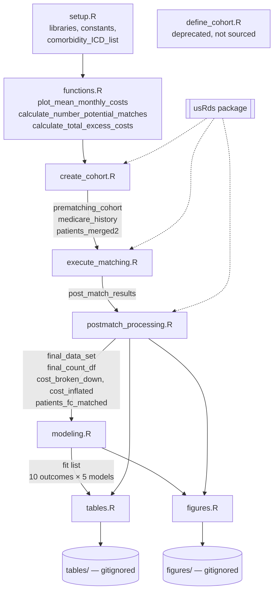
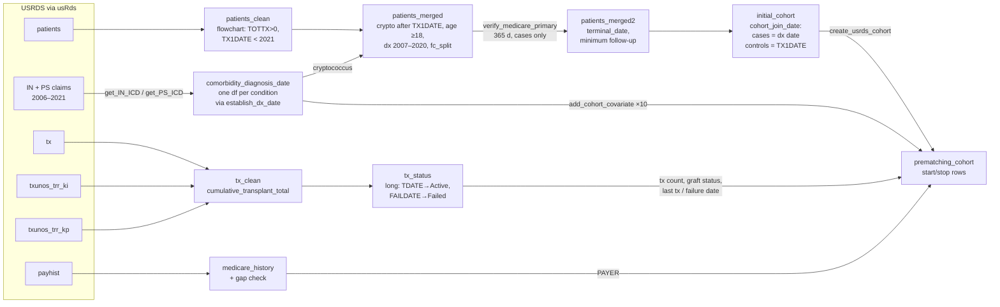
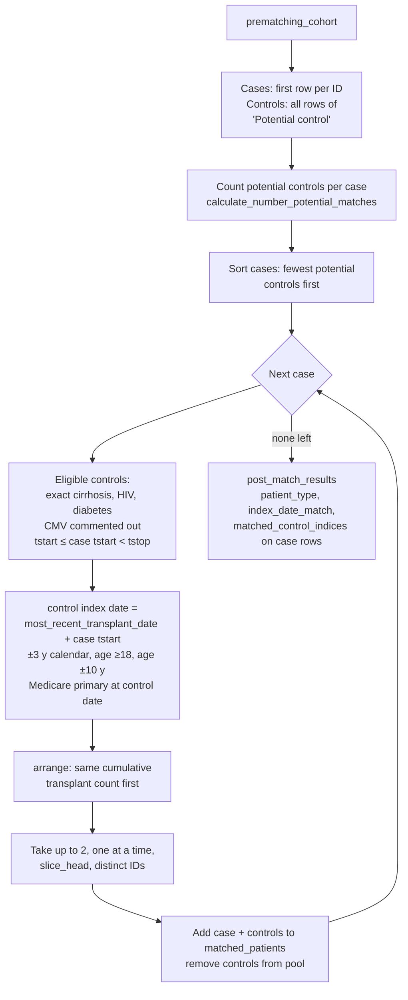
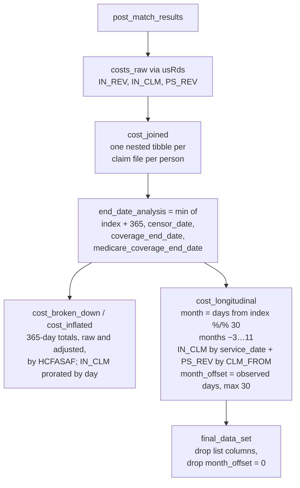
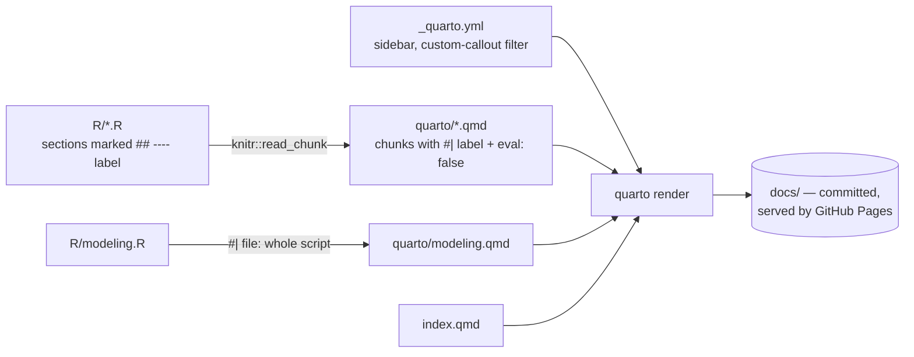

# Cryptococcus Cost Analysis Architecture

> Describes `master` at commit `8a52330` (2026-10-23). Unpushed local changes are not reflected. Nothing was executed; this document comes from reading the code. USRDS data were not available.

## Overview

The project estimates excess Medicare cost after cryptococcosis in kidney transplant recipients, using USRDS data (linked UNOS and Medicare) accessed through the separate `usRds` package. It works in four stages:

1. Build a time-varying cohort of transplant recipients.
2. Match each case at diagnosis to up to `number_controls_per_case` (2) never-diagnosed controls, using risk-set matching on time since transplant.
3. Turn each person's claims into an inflation-adjusted cost panel by month, from month −3 to month 11 around the index date.
4. Fit cost models in which `patient_type × month` gives the case–control cost difference.

A Quarto website in `quarto/` explains each script and displays its code in `eval: false` chunks. The site never runs the analysis. It is rendered to `docs/` and served by GitHub Pages.

## Script and Object Flow

`R/main.R` sources the scripts in order. Every script uses objects that earlier scripts left in the global environment; no script saves or loads intermediate files.



### Hidden dependencies

Some functions read globals instead of taking them as arguments:

- `calculate_number_potential_matches()` reads `medicare_history`, created in `create_cohort.R`.
- `plot_mean_monthly_costs()` defaults `countdf = final_count_df`, created in `postmatch_processing.R`. R evaluates the default only when the function is called, so this works from `figures.R` but not earlier.
- `create_cohort.R` sources `setup.R` a second time. Harmless, but it reloads every library.
- `define_cohort.R` is marked deprecated, uses the older `strobe` API, and is sourced by nothing. `setup.R` still loads `strobe` for it.

## Components

### Setup

**Purpose**: Load libraries and define analysis-wide constants and ICD code lists.

**Location**: `R/setup.R`

**Key symbols**:
- `censor_date`, `minimum_followup`, `maximum_followup` — follow-up window
- `number_controls_per_case` — target matching ratio
- `inflation_month`, `inflation_year` — inflation baseline
- `baseline_months_cost`, `full_months` — pre-index months and the month range of the panel
- `cryptococcus_ICD_list`, `comorbidity_ICD_list` — ICD-9-CM and ICD-10-CM code lists by condition

**Interactions**: Read by every later script.

### Helper functions

**Purpose**: Functions shared across scripts.

**Location**: `R/functions.R`

**Key functions**:
- `calculate_number_potential_matches()` — counts eligible controls for one case, used to order the greedy match
- `calculate_total_excess_costs()` — sums `patient_type:month` interaction coefficients and their variance (linear branch; log branch exists)
- `plot_mean_monthly_costs()` — `emmeans` predictions by group and month at `month_offset = 30`, with a risk table underneath

### Cohort construction

**Purpose**: Build the time-varying cohort of transplant recipients with cases, potential controls, and time-varying covariates.

**Location**: `R/create_cohort.R` (sections `load-usrds-files`, `initialize-flowchart`, `comorbidities-medicare`, `develop-flowchart`, `time-varying-cohort`)



**Output**: `prematching_cohort`, a counting-process data set with one row per person per interval (`tstart`, `tstop`). After `finalize_usrds_cohort()`, time is days since `most_recent_transplant_date`. Comorbidities, graft status and payer vary over time within a person.

Cases enter at diagnosis, so a case's first row has `tstart` equal to the days from their most recent transplant to diagnosis. That value is their matching time. Controls run from `TX1DATE` to `terminal_date`.

The `flowchart` package objects (`patients_clean`, `patients_merged`, `patients_merged2`) carry the exclusion counts for the STROBE diagram.

### Matching

**Purpose**: Greedy risk-set matching of cases to controls without replacement.

**Location**: `R/execute_matching.R` (sections `prepare-cohort`, `count-potential-matches`, `matching-loop`)



**Output**: `post_match_results`, which stacks cases and controls with `patient_type` and `index_date_match`. The only record of the matched set is the list column `matched_control_indices` on case rows.

### Post-match processing

**Purpose**: Attach claims, define the follow-up window, compute 365-day totals, and build the monthly cost panel.

**Location**: `R/postmatch_processing.R` (sections `matched-flowchart`, `raw-costs`, `merge-costs`, `total-costs`, `prorated-costs`, `inflation-adjustment`, `monthly-costs`, `final-data-set`)



One person's timeline in the panel:

```
day:    −90      −60      −30       0        30      ...     330      360
month:  [  −3   ][  −2   ][  −1   ][   0   ][   1  ] ... [  11  ]
                                   ^ index_date_match (case: dx date; control: matched date)
month_offset = days observed in each month, capped at 30; follow-up ends at end_date_analysis
```

Details that are easy to miss:

- `IN_REV` feeds only the 365-day totals. The monthly panel and all models use `IN_CLM` and `PS_REV`; `grand_total_cost_month` is `IN_CLM_month_total + PS_REV_month_total`.
- Monthly sums are floored at 0 with `pmax()`, which absorbs negative adjustment claims.
- `final_count_df` (persons per group per month) is the risk table under each monthly plot.

### Modeling

**Purpose**: Fit monthly cost models for each outcome.

**Location**: `R/modeling.R` (no section labels; the page includes the whole file)

For each of 10 outcomes (grand total, `IN_CLM` total, `PS_REV` total, and seven `IN_CLM` service categories), five models are fitted, all with `patient_type * factor(month) + offset(log(month_offset))`, clustered on `USRDS_ID`:

| Key in `fit[[outcome]]` | Engine | Outcome scale | Family |
|---|---|---|---|
| `glmmTMB$tweedie` | glmmTMB, random intercept | dollars | Tweedie, log link |
| `glmmTMB$linear` | glmmTMB, random intercept | dollars | Gaussian, identity |
| `gee$linear` | geeglm, exchangeable | dollars | Gaussian, identity |
| `glmmTMB$log` | glmmTMB, random intercept | `log1p` dollars | Gaussian, identity |
| `gee$log` | geeglm, exchangeable | `log1p` dollars | Gaussian, identity |

The reference level of `factor(month)` is −3, the lowest month, so each interaction term is a case–control difference relative to month −3.

### Tables and figures

**Location**: `R/tables.R`, `R/figures.R`

- Table 1 (`table1`) summarizes `post_match_results` by `patient_type`; saved to `tables/`.
- Table 2 (`table2_icd`) lists the ICD codes from `comorbidity_ICD_list`; saved to `tables/`.
- Cost summary tables from `cost_broken_down` and `cost_inflated` are printed, not saved.
- The total excess cost comes from `calculate_total_excess_costs()` on `fit$grand_total_cost_month$gee$linear`.
- Figures: the final flowchart (`patients_fc_matched`), a beeswarm of 365-day `IN_CLM` totals, and one monthly plot per outcome and model via `plot_mean_monthly_costs()`; saved to `figures/`.

`tables/` and `figures/` are gitignored, so saved outputs cannot be checked from GitHub.

## Website Build



- Each page calls `knitr::read_chunk()` on its script, then shows sections by label. A script edit appears on the site at the next render, with no page edit.
- `quarto/modeling.qmd` includes the whole script with `#| file:`, so it displays everything in `modeling.R`, including unused blocks.
- `_quarto.yml` defines the sidebar, the `custom-callout` filter (the `Rcode` callout), and `output-dir: docs`.
- `docs/` must be re-rendered and committed after any script or page change, or the live site goes stale.

## Configuration

| Setting | Where | Effect |
|---|---|---|
| `censor_date` | `R/setup.R` | Administrative end of follow-up |
| `minimum_followup`, `maximum_followup` | `R/setup.R` | Case inclusion; 365-day cost window |
| `number_controls_per_case` | `R/setup.R` | Target controls per case |
| `inflation_month`, `inflation_year` | `R/setup.R` | Baseline for `adjust_costs_for_inflation()` |
| `baseline_months_cost`, `full_months` | `R/setup.R` | Pre-index months; panel month range |
| `comorbidity_ICD_list` | `R/setup.R` | Condition definitions for cases and covariates |
| Matching calipers (±3 y calendar, ±10 y age, age ≥18) | `R/execute_matching.R`, `R/functions.R` | Hard-coded in both places |
| Site navigation, theme, output dir | `_quarto.yml` | Website structure |

## Code References

| Component | File | Key symbols |
|---|---|---|
| Entry point | `R/main.R` | sourcing order |
| Constants, code lists | `R/setup.R` | `censor_date`, `number_controls_per_case`, `full_months`, `comorbidity_ICD_list` |
| Helpers | `R/functions.R` | `calculate_number_potential_matches()`, `calculate_total_excess_costs()`, `plot_mean_monthly_costs()` |
| Cohort | `R/create_cohort.R` | `tx_status`, `medicare_history`, `patients_merged2`, `prematching_cohort` |
| Matching | `R/execute_matching.R` | `unmatched_patients`, matching `while` loop, `post_match_results` |
| Costs and panel | `R/postmatch_processing.R` | `end_date_analysis`, `cost_inflated`, `cost_longitudinal`, `final_data_set`, `final_count_df` |
| Models | `R/modeling.R` | `temp_formula`, `fit[[outcome]][[engine]][[family]]` |
| Outputs | `R/tables.R`, `R/figures.R` | `table1`, `table2_icd`, monthly plot loop |
| Deprecated | `R/define_cohort.R` | older `strobe`-based cohort script |
| Website | `_quarto.yml`, `index.qmd`, `quarto/*.qmd`, `_extensions/` | `read_chunk`, `custom-callout` |
| External (usRds) | — | `load_usrds_file`, `get_IN_ICD`, `get_PS_ICD`, `establish_dx_date`, `verify_medicare_primary`, `create_usrds_cohort`, `add_cohort_covariate`, `finalize_usrds_cohort`, `get_IN_REV_costs`, `get_IN_CLM_costs`, `get_PS_REV_costs`, `prorate_costs_by_day`, `adjust_costs_for_inflation` |

## Known Architectural Gaps

Status as of commit `8a52330`. These come from reading the code and need checking against the real data where noted.

- **Matched-set ID is lost before modeling.** `matched_control_indices` is a list column, and `final_data_set` drops list columns. Models can cluster only on `USRDS_ID`. *(Needs a design decision.)*
- **Death is not an input to `end_date_analysis`.** `DIED` appears only in the `follow_up_final_event` label. Post-death months stay in the panel unless a coverage end date already equals the death date. *(Needs verification: count person-months after `DIED` by `patient_type`.)*
- **Open items from earlier reviews, still present:** `calculate_total_excess_costs()` sums months −2 and −1 interactions; `slice_head(n = 1)` makes `set.seed()` ineffective; the potential-match count checks coverage at a different date than the loop; controls are limited to never-diagnosed patients; graft status isn't matched; cases with zero controls are still added as matched.
- **Partly fixed:** `temp_formula` and `fit` are now initialized; the unused GEE tweedie block at the end of `modeling.R` still runs when sourced.

## Glossary

| Term | Definition |
|---|---|
| Case | Transplant recipient with an incident cryptococcosis claim meeting the cohort criteria; index date is the diagnosis date |
| Potential control | Transplant recipient with no cryptococcosis diagnosis at any time |
| Index date (`index_date_match`) | Case: diagnosis date. Control: `most_recent_transplant_date` plus the case's days since transplant |
| Risk-set matching | Controls must be under observation at the same time since transplant as the case's diagnosis |
| `tstart` / `tstop` | Interval bounds in days since most recent transplant, from `finalize_usrds_cohort()` |
| `month` | Floor of days from index divided by 30; panel covers −3 to 11 |
| `month_offset` | Days observed in a panel month, capped at 30; used as the model offset |
| IN_CLM / IN_REV / PS_REV | Institutional claims, institutional revenue-center lines, and physician/supplier lines from USRDS Medicare files |
| HCFASAF | Claim setting (inpatient, outpatient, SNF, home health, hospice, dialysis, auxiliary) used to split costs |
| usRds | Separate package that loads USRDS files and provides cohort, coverage and cost helpers |
